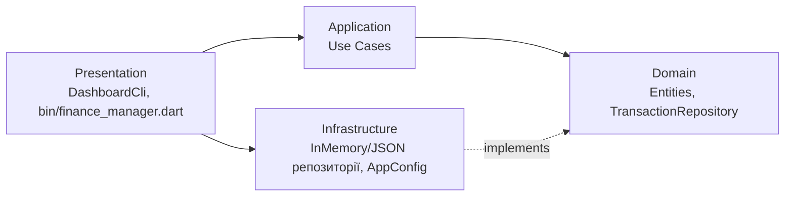

# Finance Manager

Консольний застосунок «Фінансовий менеджер» (екран дашборду): баланс,
швидкі дії (Відправити / Отримати / Платіж / Ще) і список останніх
транзакцій. Написаний на Dart за принципами Clean Architecture.

Автор: Туз Ангеліна, група 4КІ-3, варіант 18.

## Політика гілок
- main: стабільний код, лише релізи (теги);
- develop: інтеграційна гілка;
- feature/*: гілки під конкретні задачі (по одній на шар).

## Схема архітектури



Залежності спрямовані всередину: зовнішні шари залежать від внутрішніх.
Domain ні від чого не залежить. Application знає лише інтерфейс
TransactionRepository. Infrastructure реалізує цей інтерфейс.
Presentation збирає все разом через Dependency Injection.

## Структура проєкту

```
bin/finance_manager.dart            точка входу, DI
config/settings.json                налаштування
lib/domain/                         сутності та інтерфейси
lib/application/use_cases/          use cases
lib/infrastructure/                 репозиторії та конфігурація
lib/presentation/cli/               консольний інтерфейс
```

## Збірка і запуск

Потрібен Dart SDK 3.0 або новіший (входить до складу Flutter).

```
git clone https://github.com/ТВІЙ_ЛОГІН/finance_manager.git
cd finance_manager
dart run bin/finance_manager.dart
```

У Windows перед запуском виконайте `chcp 65001` для коректної кирилиці.

## Зміна способу зберігання даних

У файлі config/settings.json:
- "storage": "memory": дані в пам'яті;
- "storage": "json": дані у файлі dataFile.

## Use cases
Додати транзакцію, видалити транзакцію, останні транзакції,
підрахунок балансу.